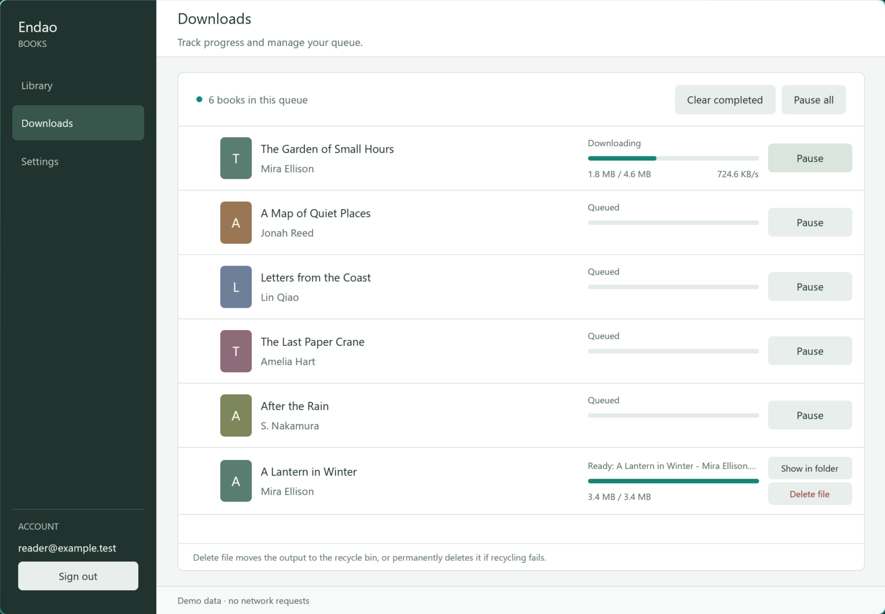
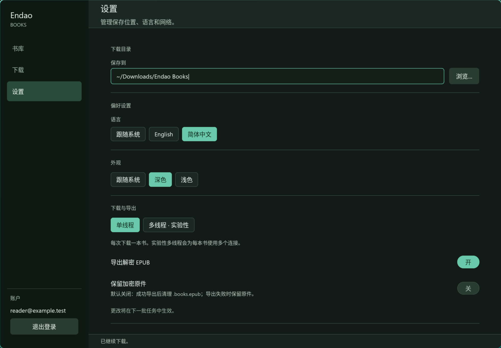

# Endao Desktop

Native GPUI client for Windows, macOS, and Linux. The project is intentionally self-contained and uses a Rust implementation for login, purchased-book listing, legacy book downloads, resumable HTTP ranges, and sanitized LCP EPUB export.

## Build

Install Rust stable and the native desktop build dependencies for your platform, then run:

```sh
cargo build --release --locked
```

Linux needs the X11/Wayland, XKB, fontconfig, and OpenGL development packages. The GitHub Actions workflow builds release binaries on Ubuntu, macOS, and Windows. The macOS job uses the Apple Silicon `macos-15` runner, verifies the binary's ARM64 architecture before upload, and publishes it as `endao-desktop-macos-arm64`.

## Use

Start the app with `cargo run --release --locked`. The client opens to a sign-in view, then uses separate Library, Downloads, and Settings pages. Select books in Library and start the queue. Downloads provides a Pause/Resume button for each pending or downloading book, Pause all / Resume all, and Clear completed. Clearing completed entries removes queue records and keeps the exported files and purchased library. Sign out is in the account area at the bottom of the sidebar.

Each completed download has Show in folder and Delete file controls. Show in folder reveals the output in Explorer/Finder or the Linux file manager; Linux falls back to opening its containing folder if the desktop portal cannot reveal the file. Delete file first moves the output to the system recycle bin or Trash, and falls back to permanently deleting that file if recycling fails. The queue shows whether it was recycled, permanently deleted, or already missing. Failed deletion keeps the task available for retry. Only the completed output is deleted; any retained encrypted original stays in place. Deleted records can be cleared with Clear completed, and the book remains in your purchased library. File actions run independently of other downloads; deletion disables that task's actions until it completes.

Downloads use the legacy `POST /api/v4/book/download` endpoint and default to one connection per book, one book at a time. Settings → Download & export offers experimental parallel downloading with 2–16 connections per book (4 initially); servers without range support fall back to a single stream. Existing settings files also start in single-thread mode until experimental parallel downloading is explicitly enabled. These preferences apply to the next queue.

Pausing a task retains its partial data, closes that transfer, and lets the next unpaused book run. Resuming puts the task back into the queue; it continues from its saved byte offsets when the active book finishes. The task stays paused if other tasks are resumed individually. Pause all / Resume all apply to all pending or downloading tasks. A task already exporting finishes its export. Signing out stops the queue, clears the account from memory, and keeps partial files. To resume after signing in again or restarting the app, select the same book and download to the same folder using the same download mode.

Export names use the fetched title and author, such as `书名 - 作者.epub` and `Book Title - Author Name.books.epub`. Spaces and Unicode are preserved, invalid filename characters are sanitized, and duplicate title/author combinations receive a book ID suffix so different editions do not overwrite each other.

The interface follows the system language and appearance by default and supports English, Simplified Chinese, Light, and Dark modes. In System theme mode, GPUI's window-appearance event updates the palette when the OS theme changes; manual theme choices stay fixed across system changes. Proxy mode defaults to system settings, with manual HTTP and SOCKS5 options. System mode reads static proxy settings supported by the OS integration and falls back to `HTTP_PROXY`/`HTTPS_PROXY` environment variables. PAC files and authenticated proxy URLs are not supported; enter proxy endpoints as `host:port`.

Text fields support mouse drag selection, double-click word selection, Shift-click, Shift+arrow selection, and Ctrl+Shift+arrow word selection on Windows/Linux (Option+Shift+arrow on macOS). Home/End, select all, copy, cut, paste, and Unicode-aware deletion work within each field; long text scrolls horizontally to keep the caret visible. Passwords are masked and cannot be copied or cut. Tab/Shift+Tab move between the visible fields. Chinese input uses GPUI's native input-method interface, including preedit text, candidate commits, and candidate-window positioning. Preedit text does not filter the library or save settings until committed, and confirming an IME candidate does not submit the login form.

The macOS ARM64 CI artifact contains the raw binary, `endao-desktop-macos-arm64.app.zip`, and `endao-desktop-macos-arm64.dmg`. Extracting the ZIP produces `Endao Books.app` with its executable permissions preserved. The DMG contains the app and a shortcut to Applications for drag-and-drop installation. Packaging validates the ARM64 architecture, bundle metadata, ad-hoc signature, ZIP, and DMG. Developer ID signing and notarization require the distributor's Apple credentials and are left for release publishing.

To build and package locally on macOS, run:

```sh
MACOSX_DEPLOYMENT_TARGET=12.0 cargo build --release --locked
sh scripts/package_macos.sh target/release
```

The bundle and archives are written to `target/release`. GitHub Actions uses the Node 24 versions `actions/checkout@v6` and `actions/upload-artifact@v6`.

Run `cargo test --locked` or `cargo nextest run --locked` for the GPUI interaction tests and network/DRM unit tests. Nextest is useful for faster local iteration and parallel test execution. The UI test drives real GPUI mouse and keyboard events through the navigation, account, settings, and download controls at the default 1180 x 820 window size.

For a native preview with synthetic books and no network requests or saved settings, run `cargo run --locked -- --demo library`. Other demo start pages are `downloads`, `settings`, and `login`. Demo mode skips `.env` loading and clears any inherited account values before rendering. On Hyprland versions with the Lua dispatcher API, `python3 scripts/ui_smoke_hyprland.py --binary target/release/endao-desktop` exercises selection, pause/resume, language switching and sign out on the actual Wayland renderer. It uses `hyprctl` and `grim`, captures only its own demo window, and restores focus and pointer position afterward.

`python3 scripts/input_smoke_hyprland.py --binary target/release/endao-desktop` captures native text selection. Add `--ime --x11` to exercise the currently configured Fcitx5 engine through XWayland/XIM using `xdotool`: it types `nihao`, confirms the first candidate, and captures the preedit and committed text. A Chinese engine must already be configured. The script restores the input method's activation state, focus, and pointer, without changing the engine or using the clipboard. Hyprland's directed shortcut API bypasses Wayland input methods, so this script requires XIM for IME testing. Local Chinese candidate submission was verified with Fcitx5/Rime on XWayland; native Wayland and Windows IME desktop testing remain to be done.

The native smoke test also switches between dark, light, and system themes. Add `--check-system-theme` to verify live OS theme changes using the GNOME desktop `color-scheme` setting exposed through XDG Desktop Portal. This option briefly switches that system setting and restores its original value when the test exits. It also checks the rendered page color and verifies that a manual light override survives system changes. The regular smoke test changes only the demo app's theme.

The live account test is opt-in: `cargo test --locked live_old_path_downloads_and_exports_a_clean_epub -- --ignored`. It reads `ED_EMAIL` and `ED_PASSWORD` from the environment or `../.env`, downloads a purchased book to a temporary folder using its title and author, decrypts it, checks archive entries, and removes the temporary files.





Decrypted exports are written as ordinary `.epub` files. By default, a successful export automatically removes its `.books.epub` encrypted source. Enable Keep encrypted originals in Settings → Download & export to retain both files. Failed exports and downloads without automatic decryption always keep the encrypted source. Exports use a temporary file and replace the destination only after export and disk sync succeed. A source cleanup failure is shown as a warning on the completed task, and the successful export is kept. LCP license and encryption files, plus account-related OPF metadata, are removed from the exported copy. The password is kept in memory only; the app saves download, export, appearance, language, and proxy preferences in the platform config directory.

The default client identity uses generic values (`Android Device`, `Android SDK_35`) and a newly generated device ID. It does not use device identifiers copied from packet captures.

UI code lives in `src/ui/`: application state/events in `mod.rs`, actions in `actions.rs`, background jobs in `jobs.rs`, file action state in `file_actions.rs`, library/download layouts in `views.rs`, settings in `settings_view.rs`, reusable controls in `widgets.rs`, the window/sidebar in `shell.rs`, native text input/IME in `input/`, and isolated demo fixtures/tests in their own modules. `src/queue.rs` schedules individually pausable tasks, and `src/export.rs` handles staged exports and source retention. `src/file_actions.rs` integrates native file-manager reveal and recycle-bin deletion with a direct-delete fallback. `src/theme.rs` contains the theme preference and shared palettes. Portable export naming is in `src/filenames.rs`; HTTP resume logic remains in `src/downloader.rs`.
