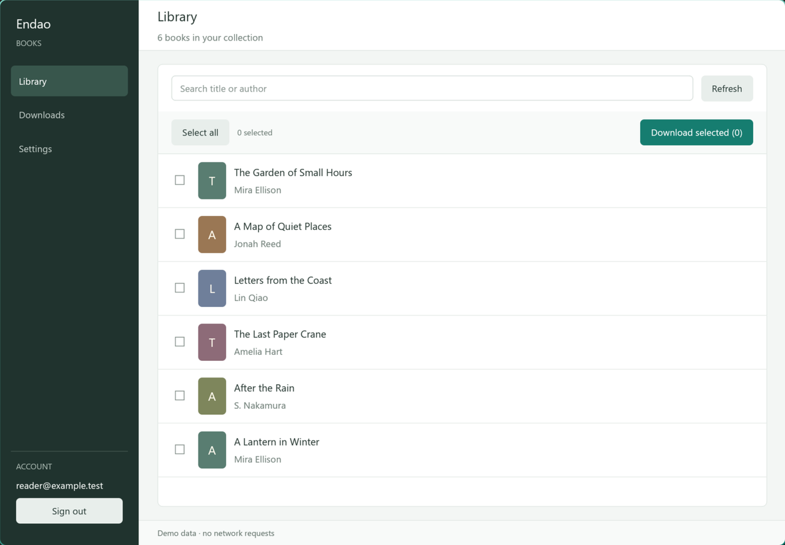
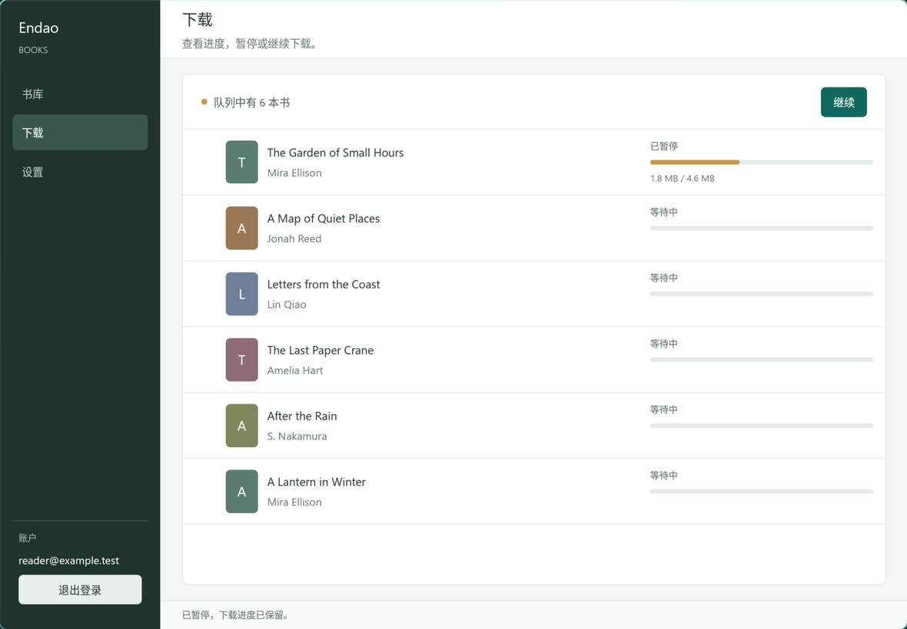

# Endao Desktop

Native GPUI client for Windows, macOS, and Linux. The project is intentionally self-contained and uses a Rust implementation for login, purchased-book listing, legacy book downloads, resumable HTTP ranges, and sanitized LCP EPUB export.

## Build

Install Rust stable and the native desktop build dependencies for your platform, then run:

```sh
cargo build --release --locked
```

Linux needs the X11/Wayland, XKB, fontconfig, and OpenGL development packages. The GitHub Actions workflow builds release binaries on Ubuntu, macOS, and Windows.

## Use

Start the app with `cargo run --release --locked`. The client opens to a sign-in view, then uses separate Library, Downloads, and Settings pages. Select books in Library and start the queue; pause and resume controls are on Downloads. Sign out is in the account area at the bottom of the sidebar.

Downloads use the legacy `POST /api/v4/book/download` endpoint. Range capable servers use parallel parts; otherwise the client uses a resumable `.part` stream. Pause and Resume control the current queue, including all its active workers. Pausing keeps partial data on disk; connections that close during a pause reconnect using the saved byte offsets. Signing out stops the queue, clears the account from memory, and keeps partial files. To resume after signing in again or restarting the app, select the same book and download to the same folder.

Export names use the fetched title and author, such as `书名 - 作者.epub` and `Book Title - Author Name.books.epub`. Spaces and Unicode are preserved, invalid filename characters are sanitized, and duplicate title/author combinations receive a book ID suffix so different editions do not overwrite each other.

The interface follows the system language and appearance by default and supports English, Simplified Chinese, Light, and Dark modes. In System theme mode, GPUI's window-appearance event updates the palette when the OS theme changes; manual theme choices stay fixed across system changes. Proxy mode defaults to system settings, with manual HTTP and SOCKS5 options. System mode reads static proxy settings supported by the OS integration and falls back to `HTTP_PROXY`/`HTTPS_PROXY` environment variables. PAC files and authenticated proxy URLs are not supported; enter proxy endpoints as `host:port`.

Run `cargo test --locked` for the GPUI interaction tests and network/DRM unit tests. The UI test drives real GPUI mouse and keyboard events through the navigation, account, settings, and download controls at the default 1180 x 820 window size.

For a native preview with synthetic books and no network requests or saved settings, run `cargo run --locked -- --demo library`. Other demo start pages are `downloads`, `settings`, and `login`. Demo mode skips `.env` loading and clears any inherited account values before rendering. On Hyprland versions with the Lua dispatcher API, `python3 scripts/ui_smoke_hyprland.py --binary target/release/endao-desktop` exercises selection, pause/resume, language switching and sign out on the actual Wayland renderer. It uses `hyprctl` and `grim`, captures only its own demo window, and restores focus and pointer position afterward.

The native smoke test also switches between dark, light, and system themes. Add `--check-system-theme` to verify live OS theme changes using the GNOME desktop `color-scheme` setting exposed through XDG Desktop Portal. This option briefly switches that system setting and restores its original value when the test exits. It also checks the rendered page color and verifies that a manual light override survives system changes. The regular smoke test changes only the demo app's theme.

The live account test is opt-in: `cargo test --locked live_old_path_downloads_and_exports_a_clean_epub -- --ignored`. It reads `ED_EMAIL` and `ED_PASSWORD` from the environment or `../.env`, downloads a purchased book to a temporary folder using its title and author, decrypts it, checks archive entries, and removes the temporary files.




Decrypted exports are written as ordinary `.epub` files. The encrypted source is kept alongside it as `.books.epub`. LCP license and encryption files, plus account-related OPF metadata, are removed from the exported copy. The password is kept in memory only; the app saves the output directory, worker count, language, and proxy settings in the platform config directory.

The default client identity uses generic values (`Android Device`, `Android SDK_35`) and a newly generated device ID. It does not use device identifiers copied from packet captures.

UI code lives in `src/ui/`: application state/events in `mod.rs`, actions and background jobs in `actions.rs`, page layouts in `views.rs`, reusable controls in `widgets.rs`, the window/sidebar in `shell.rs`, and isolated demo fixtures/tests in their own modules. `src/theme.rs` contains the theme preference and shared palettes. Portable export naming is in `src/filenames.rs`; worker pause/cancel and HTTP resume logic remain in `src/downloader.rs`.
